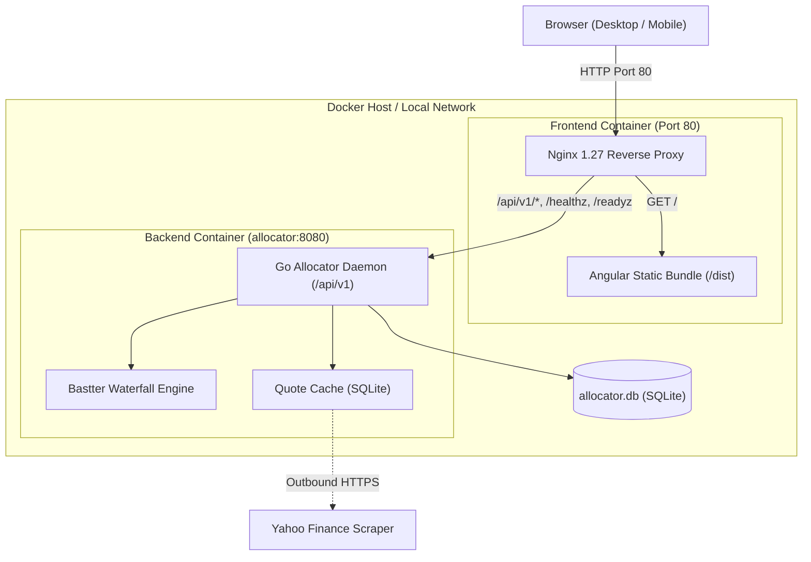
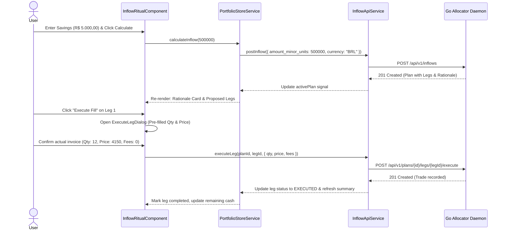

# Investments Allocator Web Frontend

*   **Author:** Gabriel <gabrielssc.ti@gmail.com>
*   **Status:** Draft
*   **Date:** 2026-11-16

--------------------------------------------------------------------------------

## Overview

The Investments Allocator Web Frontend (`investments-allocator-fe`) is a single-user, personal web application built with Angular 18/19 and Angular Material. It functions as an operational console for the existing Go backend service (`investments-allocator`), which implements the **Bastter greedy waterfall portfolio rebalancing methodology**.

The application provides a disciplined, usability-first interface for two primary workflows:
1. **The Monthly Inflow Ritual:** Inputting monthly savings in Brazilian Real (BRL), executing the greedy waterfall calculation, inspecting the transparent mathematical rationale behind asset selection, and recording real-world broker invoice fills leg-by-leg.
2. **Portfolio & Asset Maintenance:** Mirroring broker holdings, registering micro-assets under macro asset classes (with free-form ticker and auto-suggested `.SA` suffix for Brazilian instruments), updating conviction scores (0–10), and maintaining baseline quantities and fixed-income balances.

The frontend is containerized using Docker and served via an Nginx reverse proxy that routes API requests directly to the Go daemon (`http://allocator:8080`), eliminating cross-origin resource sharing (CORS) setup. It provides Day-0 responsive layouts via Angular CDK `BreakpointObserver`, delivering dense information tables on desktop and stacked card workflows on mobile devices.

--------------------------------------------------------------------------------

## The Problem

The Bastter methodology achieves portfolio rebalancing exclusively through new capital inflows, completely rejecting asset sales to eliminate tax drag and market-timing errors. When new capital arrives, the engine determines which underweight macro asset class and micro security have the largest monetary deficit, directing the full contribution to the single neediest asset (or across multiple greedy waterfall legs).

Currently, interacting with the backend service requires executing manual `curl` commands and parsing raw JSON responses via terminal scripts. This introduces several operational pain points:
* **High Operational Friction:** Entering JSON payloads manually for monthly contributions and broker invoice settlements is cumbersome and prone to typographical errors.
* **Cognitive Opacity:** Inspecting raw JSON leaves the user uncertain about *why* a particular security was chosen over others, masking whether competing assets were bypassed due to the *Freio* circuit breaker, governance quarantine, whole-share lot constraints, or stale market quotes.
* **Real-World Execution Slippage:** The allocator outputs advisory proposals based on cached market prices. When executing orders on a brokerage, fill prices slip, transaction fees apply, and odd-lot constraints alter fill quantities. Furthermore, fixed-income accounts accumulate daily interest (CDI/Selic). Manually adjusting and executing multi-step REST payloads to account for these variances is error-prone.
* **Initial Setup Overhead:** Mirroring an existing brokerage account requires registering numerous instruments, assigning conviction scores, and establishing baseline holdings. Executing this sequentially through CLI tools creates unnecessary friction.

The proposed frontend solves these bottlenecks by providing a focused, high-density web console tailored strictly for routine monthly capital deployment and portfolio synchronization.

--------------------------------------------------------------------------------

## Goals

*   **G-1: Streamlined Monthly Inflow Workflow:** Provide a single-view operational flow to input monthly savings in BRL, invoke the Bastter greedy waterfall engine (`POST /api/v1/inflows`), and review proposed allocation legs with an explicit display of selection rationale (macro deficit $\Delta_i$, micro deficit $\delta_j$, conviction score $s_j$, and exclusion audit badges).
*   **G-2: Independent Advisory Trade Settlement:** Enable recording broker fill invoices leg-by-leg (`POST /api/v1/plans/{id}/legs/{legId}/execute`) with pre-populated, editable inputs (actual fill quantity and unit price for equities; contribution amount and broker statement balance reconciliation for fixed income; fees defaulting to zero). Support partial plan execution where unexecuted legs can be ignored and automatically superseded by subsequent inflows.
*   **G-3: Portfolio Mirroring & Maintenance Workspace:** Provide a clear dashboard displaying macro class allocations (target bps vs. current bps, target minor units vs. current minor units, and monetary deltas) and a management interface to register new assets (with auto-suggested `<TICKER>.SA` suffixes for B3 assets), update conviction scores (0–10), and adjust baseline holdings.
*   **G-4: Zero Financial Math on Client:** The Go backend remains the single source of truth for portfolio valuation, weight normalization, and waterfall calculations. The frontend handles monetary values strictly as integer minor units (`int64` cents) and target allocations as integer basis points (`bps`, 10,000 bps = 100%), using custom bidirectional directives to prevent JavaScript floating-point rounding drift.
*   **G-5: Single-Port Containerized Architecture:** Containerize the application using a multi-stage Docker build with Nginx reverse proxying `/api/v1/`, `/healthz`, and `/readyz` to `http://allocator:8080`, eliminating browser CORS configuration and simplifying deployment.
*   **G-6: Day-0 Responsive Support:** Leverage Angular CDK `BreakpointObserver` to deliver high-density data tables on desktop viewports and adaptive single-column card flows on mobile screens.

--------------------------------------------------------------------------------

## Non-Goals

*   **NG-1: Multi-Currency & Foreign Exchange:** The frontend operates exclusively in Brazilian Real (`BRL`). Multi-currency conversion and foreign exchange rate caching are out of scope.
*   **NG-2: Historical Audit Ledger Explorer:** Browsing past inflow history or querying historical trade ledgers (`GET /api/v1/inflows`, `GET /api/v1/plans`) is excluded. The UI focuses strictly on active portfolio state and the immediate monthly allocation session.
*   **NG-3: Client-Side Rebalancing Simulation:** The frontend will not simulate pro-rata rebalancing, projected future growth, or hypothetical allocations. All decision math is delegated to the Go engine.
*   **NG-4: Sell Orders & Asset Liquidation:** The UI strictly contains no sell order generators or portfolio liquidation features, adhering to the Bastter buy-only invariant.
*   **NG-5: Multi-User Authentication & Authorization:** The application is a personal, single-user system. Authentication, user roles, session tokens, and multi-tenancy are out of scope.
*   **NG-6: Browser-Side Web Scraping:** Direct client-side quote scraping via `yahoo-finance2` is excluded due to browser CORS restrictions and architectural duplication. All quote fetching remains isolated in the Go backend.
*   **NG-7: Live Streaming & Intraday Charting:** Intraday price ticker streams, WebSocket connections, and complex financial charts (candlesticks, technical indicators) are explicitly excluded to maintain behavioral focus and operational simplicity.

--------------------------------------------------------------------------------

## Open Questions

*   *None at this stage.* (Core architectural, domain, and operational questions have been resolved during ideation).

--------------------------------------------------------------------------------

## Critical User Journeys (CUJs)

### CUJ 1: Monthly Cash Inflow Allocation & Trade Settlement

*   **Given**: The user has R$ 5.000,00 to deploy for the month and opens the application on desktop or mobile.
*   **When**: The user enters `5000,00` into the contribution field and clicks "Calculate Allocation".
*   **Then**: The application calls `POST /api/v1/inflows`, renders the generated plan (e.g., Leg 1: 12 units of `WEGE3` at R$ 41,50 per unit), displays the selection rationale (Macro deficit $+R\$ 2.400,00$, conviction score $10$, and confirms no active *Freio* lock), and presents an "Execute Fill" button.
*   **When**: The user executes the trade on their brokerage application at R$ 41,55 per unit, clicks "Execute Fill" in the frontend, verifies the pre-populated values, adjusts the fill price to `41,55`, confirms fees as `0`, and submits.
*   **Then**: The frontend calls `POST /api/v1/plans/{id}/legs/{legId}/execute`, the leg status transitions to `EXECUTED`, the holding quantity is updated in the database, and the remaining cash remainder is updated.

### CUJ 2: Initial Portfolio Mirroring & Asset Registration

*   **Given**: The user is configuring the application for the first time and needs to add an existing holding (`PETR4`) under the "National Stocks" macro class.
*   **When**: The user navigates to the "Portfolio & Assets" view and clicks "Register New Asset".
*   **Then**: A dialog opens. The user selects Macro: "National Stocks", enters Name: "Petrobras PN", and types Ticker: "PETR4". The form automatically populates the Yahoo Symbol field with "PETR4.SA". The user sets Conviction Score: `8` and clicks Save.
*   **Then**: The frontend calls `POST /api/v1/macros/National%20Stocks/instruments`. The instrument appears in the macro table. The user immediately clicks the holding quantity cell, enters their existing position (e.g., `200` units), and saves. The application calls `PUT /api/v1/positions/{id}/holding` and refreshes the portfolio net worth.

### CUJ 3: Fixed-Income Allocation Execution with Broker Reconciliation

*   **Given**: The greedy waterfall produces an allocation leg for a `BALANCE_TRACKED` fixed-income instrument (e.g., "Tesouro IPCA+ 2029") with a proposed allocation of R$ 1.200,00.
*   **When**: The user clicks "Execute Fill" on the fixed-income leg.
*   **Then**: The execution dialog displays the previously recorded balance (e.g., R$ 15.000,00) and pre-fills `balance_after` with R$ 16.200,00 (`current_balance + proposed_value`).
*   **When**: The user checks their broker account, notices that accrued interest brought the balance prior to deposit to R$ 15.085,20, edits `balance_after` to R$ 16.285,20, and clicks Confirm.
*   **Then**: The frontend posts the execution payload with `balance_after: 1628520`. The backend updates the position balance directly, eliminating interest drift for future allocation cycles.

### CUJ 4: Multi-Leg Inflow with Partial Execution (Skipping Residual Legs)

*   **Given**: The user contributes a larger lump sum (e.g., R$ 10.000,00). The greedy waterfall engine returns a multi-leg plan:
    *   Leg 1: 150 units of `WEGE3` (National Stocks) for an estimated R$ 6.225,00.
    *   Leg 2: R$ 3.750,00 allocated to a Fixed Income instrument ("Tesouro Selic").
    *   Expected remainder: R$ 25,00.
*   **When**: The user chooses to execute only the equity leg this cycle. They click "Execute Fill" on Leg 1, enter broker invoice numbers, and confirm execution.
*   **Then**: The frontend calls `POST /api/v1/plans/{id}/legs/{leg1Id}/execute`. Leg 1 transitions to `EXECUTED`, and the overall plan status transitions to `PARTIALLY_EXECUTED`.
*   **When**: The user intentionally ignores Leg 2 and closes the application or proceeds with other tasks without clicking any cancellation controls.
*   **Then**: Leg 2 remains idle in `PENDING` state. In the subsequent monthly cycle, when the user inputs a new cash inflow, the Go backend automatically marks the remaining pending leg and the plan as `SUPERSEDED`, eliminating any need for manual cleanup or forced cancellation in the UI.

--------------------------------------------------------------------------------

## Technical Plan (Architecture)

### 1. System Topology & Deployment Architecture

The frontend is packaged as an independent container that communicates with the backend daemon through a Docker network bridge. Nginx acts as a reverse proxy, hosting the Angular single-page application (SPA) while routing API requests internally to the Go backend (`allocator:8080`).



#### Key Deployment Invariants
* **Zero CORS Configuration:** The browser interacts strictly with a single origin (`http://localhost` or host IP). Nginx proxies all API traffic internally to `http://allocator:8080`, removing CORS headers and cross-origin security blocks.
* **HTML5 PushState Fallback:** Nginx handles client-side routing via `try_files $uri $uri/ /index.html;`, ensuring direct URL navigation to sub-routes functions without 404 errors.
* **Health Check Mirroring:** Probes for orchestrators (`/healthz`, `/readyz`) are proxied directly to the backend daemon to reflect true operational readiness.

---

### 2. Angular Application Architecture

The application is built using modern Angular (version 18+) standards: standalone components, signal-based reactivity, built-in template control flow (`@if`, `@for`, `@switch`), and Angular Material 3.

```
src/app/
├── core/
│   ├── interceptors/
│   │   └── api-error.interceptor.ts       # Maps backend error responses to UI notifications
│   ├── models/
│   │   ├── portfolio.models.ts            # DTOs: Summary, Macro, Instrument, Holding
│   │   └── inflow.models.ts               # DTOs: Inflow, Plan, Leg, Trade, Execution
│   └── services/
│       ├── portfolio-api.service.ts       # HTTP client for /summary, /macros, /instruments, /positions
│       ├── inflow-api.service.ts          # HTTP client for /inflows, /plans, /legs/execute
│       └── portfolio-store.service.ts     # Signal-based state store for active portfolio snapshot
├── features/
│   ├── inflow/
│   │   ├── inflow-ritual.component.ts     # Monthly savings input, calculate action, remainder banner
│   │   ├── rationale-card.component.ts    # Visual breakdown of why asset won and others were bypassed
│   │   ├── plan-legs-table.component.ts   # Responsive proposed legs list with execute triggers
│   │   └── execute-leg-dialog.component.ts# Fill dialog: equity invoice inputs and fixed-income reconciliation
│   └── maintenance/
│       ├── maintenance.component.ts       # Portfolio overview: desktop mat-table vs mobile stacked cards
│       ├── register-asset-dialog.component.ts # Micro asset registration modal with .SA auto-suggestion
│       └── score-editor.component.ts      # Inline conviction score editor (0-10)
└── shared/
    ├── directives/
    │   └── brl-currency-mask.directive.ts # Bidirectional masking: string display <-> int64 minor units
    ├── pipes/
    │   ├── brl-currency.pipe.ts           # Formats int64 minor units to R$ X.XXX,XX
    │   └── bps-percent.pipe.ts            # Formats int64 basis points (2500) to 25,00%
    └── components/
        ├── status-badge.component.ts      # Renders Freio, Quarantine, Quote Stale, Infeasible tags
        └── error-banner.component.ts      # System-wide connectivity failure banner
```

---

### 3. Reactive State Management & Component Interactions



#### State Invariants
1. **Zero Client-Side Math:** All portfolio calculations (deltas, deficits, lot sizes, remainder cash) are performed exclusively by the Go backend. Signals compute only UI-specific view transformations (e.g., table sort order, active tab index, expanded accordion states).
2. **Signal-Driven Store:** State is encapsulated in `PortfolioStoreService` exposing readonly signals:
   * `summary`: `Signal<PortfolioSummaryResponse | null>`
   * `activePlan`: `Signal<PlanResponse | null>`
   * `loading`: `Signal<boolean>`
   * `error`: `Signal<string | null>`
   * `isMobile`: `Signal<boolean>` (derived from CDK `BreakpointObserver`)

---

### 4. Data Model Specifications (TypeScript Interfaces)

The frontend contracts map 1:1 with the Go backend OpenAPI schema:

```typescript
// Core Enumerations
export type AssetKind = 'PRICE_QUOTED' | 'BALANCE_TRACKED';
export type LotRules = 'FRACTIONAL' | 'WHOLE_ONLY';
export type PlanStatus = 'PENDING' | 'PARTIALLY_EXECUTED' | 'EXECUTED' | 'CANCELLED' | 'SUPERSEDED';
export type LegStatus = 'PENDING' | 'EXECUTED' | 'CANCELLED';

// Portfolio Models (GET /api/v1/summary)
export interface InstrumentSummary {
  id: number;
  macro_name: string;
  name: string;
  ticker: string;
  yahoo_symbol?: string;
  asset_kind: AssetKind;
  currency: string;
  score: number;
  lot_rules: LotRules;
  min_investment_minor_units: number;
  quarantined: boolean;
  quarantined_note?: string;
  holding_qty?: string;
  holding_balance_minor_units?: number;
}

export interface MacroInstrumentView {
  instrument: InstrumentSummary;
  price_per_unit_minor_units: number;
  current_value_minor_units: number;
  quote_stale: boolean;
  feasible: boolean;
}

export interface MacroSummary {
  name: string;
  target_bps: number;
  current_minor_units: number;
  target_minor_units: number;
  delta_minor_units: number;
  instruments: MacroInstrumentView[];
}

export interface PortfolioSummaryResponse {
  total_minor_units: number;
  macros: MacroSummary[];
}

// Inflow Models (POST /api/v1/inflows)
export interface CreateInflowRequest {
  amount_minor_units: number;
  currency: string;
  note?: string;
  excluded_macro_names?: string[];
}

export interface InstrumentRef {
  id: number;
  ticker: string;
  name: string;
}

export interface PlanLeg {
  leg_id: number;
  sequence: number;
  instrument: InstrumentRef;
  status: LegStatus;
  proposed_qty?: string;
  proposed_price_minor_units_per_unit?: string;
  proposed_gross_minor_units: number;
  proposed_remainder_minor_units: number;
}

export interface PlanResponse {
  plan_id: number;
  inflow_id: number;
  status: PlanStatus;
  engine_version: string;
  legs: PlanLeg[];
  expected_remainder_minor_units: number;
  excluded_macro_names: string[];
}

// Trade Execution Models (POST /api/v1/plans/{id}/legs/{legId}/execute)
export interface ExecuteLegRequest {
  qty: string;
  price_minor_units_per_unit: string;
  fees_minor_units: number;
  executed_at?: string;
  balance_after?: number; // Required for BALANCE_TRACKED
}

export interface TradeResponse {
  trade_id: number;
  plan_leg_id?: number;
  instrument_id: number;
  qty: string;
  price_minor_units_per_unit: string;
  gross_minor_units: number;
  fees_minor_units: number;
  executed_at: string;
}

// Maintenance Mutation Models
export interface CreateInstrumentRequest {
  name: string;
  ticker: string;
  asset_kind: AssetKind;
  currency?: string;
  yahoo_symbol?: string;
  score: number;
  lot_rules: LotRules;
  min_investment_minor_units: number;
}

export interface UpdateInstrumentRequest {
  name?: string;
  yahoo_symbol?: string;
  score?: number;
  min_investment_minor_units?: number;
}

export interface SetHoldingRequest {
  qty?: string;
  balance_minor_units?: number;
}
```

---

### 5. Precision & Currency Input Mechanics

To eliminate JavaScript IEEE-754 floating-point drift:
* **Storage Invariant:** All monetary amounts in form models and store signals are stored as integer minor units (`int64` cents: R$ 10,50 is stored as `1050`).
* **Bidirectional Input Masking Directive (`[brlCurrencyMask]`):**
  * **On Input/Keystroke:** Strips non-digit characters, interprets digits as cents, and formats display as Brazilian Real (e.g., typing `1` $\to$ `R$ 0,01`, typing `10` $\to$ `R$ 0,10`, typing `1050` $\to$ `R$ 10,50`).
  * **On Control Value Write:** Emits integer cents (`1050`) directly to the underlying `FormControl<number>`.
* **String Decimal Formatting:** Share quantities (which can be fractional in fixed income) and unit execution prices use decimal string representations matching Go's `shopspring/decimal` library, preventing precision loss.

---

### 6. Day-0 Responsive Strategy (Angular CDK `BreakpointObserver`)

* **Breakpoint:** Handled via Angular CDK `@angular/cdk/layout` with standard threshold `(max-width: 599.98px)`.
* **Inflow Ritual Component:**
  * Uses a single-column, card-based vertical layout.
  * Desktop and mobile share the same card presentation, ensuring comfortable operation on mobile while switching between banking/brokerage apps.
* **Portfolio Maintenance Component:**
  * **Desktop ($\ge$ 600px):** Renders high-density `mat-table` (`mat-density: -2`), displaying Macro, Ticker, Name, Asset Kind, Conviction Score, Current Holdings, Valuation, Target Delta, and Action Buttons in a single dense view.
  * **Mobile (< 600px):** Automatically switches to an accordion card list. Each card displays Ticker, Score, and Current Valuation, with an "Edit" action opening an edit bottom-sheet modal. Detailed technical metadata (Yahoo Symbol, Lot Rules) is tucked into the detail drawer.

---

### 7. Containerization & Production Build Pipeline

#### Multi-Stage `Dockerfile`
```dockerfile
# Stage 1: Build Angular Static Production Assets
FROM node:22-alpine AS builder
WORKDIR /app
COPY package*.json ./
RUN npm ci
COPY . .
RUN npm run build -- --configuration=production

# Stage 2: Serve via Nginx Alpine
FROM nginx:1.27-alpine
COPY --from=builder /app/dist/investments-allocator-fe/browser /usr/share/nginx/html
COPY nginx.conf /etc/nginx/conf.d/default.conf
EXPOSE 80
HEALTHCHECK --interval=15s --timeout=3s --retries=3 \
  CMD wget -q --spider http://127.0.0.1:80/healthz || exit 1
CMD ["nginx", "-g", "daemon off;"]
```

#### Production `nginx.conf`
```nginx
server {
    listen 80;
    server_name localhost;

    root /usr/share/nginx/html;
    index index.html;

    gzip on;
    gzip_types text/plain text/css application/json application/javascript text/xml application/xml application/xml+rss text/javascript;

    # SPA Client Routing Fallback
    location / {
        try_files $uri $uri/ /index.html;
    }

    # Reverse Proxy to Go Allocator Backend
    location /api/v1/ {
        proxy_pass http://allocator:8080/api/v1/;
        proxy_http_version 1.1;
        proxy_set_header Host $host;
        proxy_set_header X-Real-IP $remote_addr;
        proxy_set_header X-Forwarded-For $proxy_add_x_forwarded_for;
        proxy_connect_timeout 5s;
        proxy_read_timeout 30s;
    }

    # Readiness & Liveness Probes
    location /readyz {
        proxy_pass http://allocator:8080/readyz;
    }

    location /healthz {
        proxy_pass http://allocator:8080/healthz;
    }
}
```

--------------------------------------------------------------------------------

## Alternatives Considered

### Alternative 1: Client-Side Yahoo Finance Integration via `yahoo-finance2`

*   **Description**: Import `yahoo-finance2` into the Angular client to query Yahoo Finance directly for live symbol search-as-you-type and creation-time symbol validation.
*   **Pros**: Enables dynamic autocomplete for tickers and instant feedback if an asset symbol does not exist on Yahoo Finance.
*   **Cons**: Yahoo Finance query endpoints do not support browser cross-origin requests (CORS), causing immediate browser fetch rejections. The library requires Node.js runtime internals and cookie/crumb session handling. Furthermore, direct client scraping duplicates the Go backend's `internal/quote` subsystem, bypassing SQLite quote caching and rate-limiting.
*   **Reason for Rejection**: Rejected by author. Browser CORS restrictions prevent client-side Yahoo queries. Free-form text input with auto-suggested `.SA` suffixes for B3 assets provides adequate ergonomics without scraping overhead.

### Alternative 2: Direct Browser-to-Backend Communication with CORS

*   **Description**: Expose the Go backend daemon port (`:8080`) directly to the browser, configure CORS middleware in the Go application, and serve the Angular SPA from a separate dev server or static port (`:4200` or `:80`).
*   **Pros**: Eliminates Nginx configuration in development.
*   **Cons**: Requires modifying the Go backend codebase to inject CORS headers and handle `OPTIONS` preflight requests. Exposes multiple container ports to the host and complicates environment-specific base URL configurations.
*   **Reason for Rejection**: Rejected by author. Deploying the frontend container with an internal Nginx reverse proxy unifies all traffic under port 80, eliminates CORS requirements, and keeps backend port 8080 internal to the Docker network.

### Alternative 3: Dedicated Multi-Page CRUD Architecture for Assets

*   **Description**: Separate portfolio management into distinct routable views: `/instruments`, `/instruments/new`, `/instruments/:id/edit`, and `/positions`.
*   **Pros**: Follows conventional RESTful admin layout patterns.
*   **Cons**: Introduces high navigational friction for a personal portfolio containing relatively few assets. Moving across multiple pages to adjust conviction scores and update quantities is cumbersome compared to a consolidated workspace.
*   **Reason for Rejection**: Rejected by author. A unified maintenance table supporting inline score updates, inline balance adjustments, and a modal asset registration dialog provides far greater operational speed.

### Alternative 4: Historical Inflow & Trade Audit Dashboard

*   **Description**: Build a historical ledger explorer to query past inflows (`GET /api/v1/inflows`), inspect previous allocation plans (`GET /api/v1/plans`), and audit past broker invoices.
*   **Pros**: Provides comprehensive historical visibility into portfolio inflows over time.
*   **Cons**: Substantially increases frontend scope and UI complexity without aiding the primary monthly ritual. The user already retains official transaction invoices and statements with their broker.
*   **Reason for Rejection**: Rejected by author. The frontend is strictly scoped to the active portfolio status and the immediate monthly allocation session.

### Alternative 5: Client-Side Waterfall Simulation & Pro-Rata Rebalancing

*   **Description**: Re-implement Bastter deficit ranking and waterfall math in TypeScript to allow client-side previewing and pro-rata rebalancing experiments.
*   **Pros**: Allows instant offline simulations without hitting backend endpoints.
*   **Cons**: Re-implementing mathematical engine logic in JavaScript introduces calculation drift, risks binary floating-point discrepancies, violates the single-source-of-truth invariant, and tempts behavioral market-timing errors.
*   **Reason for Rejection**: Rejected by author. The Go engine remains the authoritative source for all portfolio math.

### Alternative 6: Tailwind CSS Utility Styling

*   **Description**: Style the application using Tailwind CSS utilities instead of a pre-built component framework.
*   **Pros**: Complete design flexibility and minimal CSS bundle footprint.
*   **Cons**: Requires authoring and maintaining complex accessible UI controls from scratch (dialogs, high-density data tables, steppers, snackbars, and responsive drawers).
*   **Reason for Rejection**: Rejected by author. Angular Material 3 provides pre-built, functional, accessible components with built-in density scaling (`mat-density`), accelerating implementation without custom design overhead.

--------------------------------------------------------------------------------

## Non-Functional Requirements

### 1. Security & Network Isolation
* **Personal Tool Scope:** The application is strictly a personal local utility. No authentication, user authorization, or credential storage is implemented.
* **Internal Network Boundary:** When deployed with Docker Compose, the Go backend daemon does not expose port 8080 to the public host; only the Nginx frontend port (port 80) is exposed. API access occurs entirely over the internal Docker network bridge.

### 2. Performance & Precision
* **Zero Floating-Point Drift:** The application completely avoids JavaScript floating-point conversions for currency and percentage weights, maintaining integer minor units (`int64` cents) and integer basis points (`bps`).
* **Instant Interaction:** The application bundle is optimized using Angular production builds with tree-shaking and gzip compression, ensuring load times under 1 second on local networks.

### 3. Resilience & Failure Modes
* **Backend Unreachability:** If the Go daemon is stopped or unreachable, the Nginx reverse proxy returns `502 Bad Gateway`. The frontend interceptor intercepts this status and presents a persistent error banner instructing the user to check container health.
* **Quote Stale Visibility:** If Yahoo Finance fails to return a quote or external scraping fails, the instrument's `quote_stale` flag is displayed as an alert badge on both the maintenance table and the allocation rationale card.

--------------------------------------------------------------------------------

## Additional Resources

* Backend Repository: `/home/guildsmac/development/investments-allocator`
* OpenAPI Specification: `../investments-allocator/docs/openapi.yaml`
* Bastter Methodology Specification: `../investments-allocator/bastter_description.md`

--------------------------------------------------------------------------------

## Future Improvements

* **Backend Symbol Validation Hook**: Introduce a dedicated validation endpoint in the Go backend (`GET /api/v1/quotes/validate?symbol=...`) leveraging the existing `yfinance-go` provider, enabling real-time symbol search-as-you-type in the asset creation modal without violating browser CORS.
* **Automated Broker Statement Import**: Allow parsing broker PDF or CSV statements (e.g. B3 CEI/portal export) to automatically populate position quantities and fixed-income balances.

--------------------------------------------------------------------------------

## Detailed Implementation Plan

The implementation follows a modular sequence: project scaffolding and Docker configuration, core domain and API layer, shared masking directives and pipes, feature components (Inflow Ritual and Portfolio Maintenance), and end-to-end integration verification.

### Target Files to Create/Modify

#### 1. Workspace Configuration & Build System
*   **`package.json`** (`Create`)
    *   **Type / Scope**: Node.js Manifest & Dependency Specification
    *   **Proposed Changes**: Declares Angular 18/19 dependencies (`@angular/core`, `@angular/common`, `@angular/forms`, `@angular/router`, `@angular/material`, `@angular/cdk`), build tooling (`@angular/cli`, `@angular-devkit/build-angular`, `typescript`), and script commands (`start`, `build`, `test`, `lint`).
*   **`angular.json`** (`Create`)
    *   **Type / Scope**: Angular CLI Configuration
    *   **Proposed Changes**: Configures build targets (`browser`, `serve`), static asset copying, SCSS style preprocessor integration, Angular Material theme inclusion, and production build optimizations (AOT, tree-shaking, minification).
*   **`tsconfig.json` & `tsconfig.app.json`** (`Create`)
    *   **Type / Scope**: TypeScript Compiler Configuration
    *   **Proposed Changes**: Enforces strict TypeScript configuration (`strict: true`, `noImplicitAny: true`, `strictNullChecks: true`), ES2022 target, and path aliases for clean intra-package imports.
*   **`.gitignore` & `.editorconfig`** (`Create`)
    *   **Type / Scope**: Version Control & Editor Hygiene
    *   **Proposed Changes**: Excludes `node_modules/`, `dist/`, `.angular/`, and environment secrets. Enforces 2-space indentation and Unix line endings.

#### 2. Containerization & Reverse Proxy Infrastructure
*   **`Dockerfile`** (`Create`)
    *   **Type / Scope**: Multi-Stage Docker Image Recipe
    *   **Proposed Changes**: Implements Stage 1 (`node:22-alpine` compiling Angular static bundles via `npm run build -- --configuration=production`) and Stage 2 (`nginx:1.27-alpine` serving assets from `/usr/share/nginx/html`). Configures non-root user execution and container health checks.
*   **`nginx.conf`** (`Create`)
    *   **Type / Scope**: Web Server & Gateway Proxy Configuration
    *   **Proposed Changes**: Implements gzip compression, pushState HTML5 SPA client routing (`try_files $uri $uri/ /index.html;`), and reverse proxy passes for `/api/v1/`, `/healthz`, and `/readyz` routing to `http://allocator:8080` with connection timeouts.
*   **`docker-compose.yml`** (`Create`)
    *   **Type / Scope**: Container Orchestration Configuration
    *   **Proposed Changes**: Defines the `frontend` service joining the backend Docker bridge network, exposing port 80, and setting up service dependency on `allocator`.

#### 3. Core Layer (API, Models, Interceptors, and Store)
*   **`src/app/core/models/portfolio.models.ts`** (`Create`)
    *   **Type / Scope**: Domain Data Models (TypeScript Interfaces)
    *   **Proposed Changes**: Defines data structures matching Go backend DTOs for `GET /api/v1/summary`: `InstrumentSummary`, `MacroInstrumentView`, `MacroSummary`, `PortfolioSummaryResponse`, and mutation requests (`CreateInstrumentRequest`, `UpdateInstrumentRequest`, `SetHoldingRequest`).
*   **`src/app/core/models/inflow.models.ts`** (`Create`)
    *   **Type / Scope**: Inflow & Plan Domain Models (TypeScript Interfaces)
    *   **Proposed Changes**: Defines structures for `POST /api/v1/inflows` and `POST /api/v1/plans/{id}/legs/{legId}/execute`: `CreateInflowRequest`, `PlanResponse`, `PlanLeg`, `ExecuteLegRequest`, `TradeResponse`, and status types (`PlanStatus`, `LegStatus`).
*   **`src/app/core/services/portfolio-api.service.ts`** (`Create`)
    *   **Type / Scope**: Angular Injectable HTTP Service
    *   **Proposed Changes**: Implements methods wrapping backend REST endpoints: `getSummary()`, `createInstrument(macroName, payload)`, `updateInstrument(id, payload)`, `setHolding(id, payload)`, and `setQuarantine(id, payload)`.
*   **`src/app/core/services/inflow-api.service.ts`** (`Create`)
    *   **Type / Scope**: Angular Injectable HTTP Service
    *   **Proposed Changes**: Implements methods wrapping inflow endpoints: `postInflow(payload)` and `executeLeg(planId, legId, payload)`.
*   **`src/app/core/services/portfolio-store.service.ts`** (`Create`)
    *   **Type / Scope**: Signal-Based Reactive State Store
    *   **Proposed Changes**: Manages active portfolio snapshot, active plan, loading, and error signals. Ingests `BreakpointObserver` from Angular CDK to expose an `isMobile: Signal<boolean>`. Implements action methods to trigger inflows and leg executions while keeping client-side state synchronized without performing local financial math.
*   **`src/app/core/interceptors/api-error.interceptor.ts`** (`Create`)
    *   **Type / Scope**: Angular Functional HTTP Interceptor
    *   **Proposed Changes**: Intercepts HTTP errors, extracts backend structured error details (`code`, `message`, `details`), and notifies the store to render diagnostic banners or snackbars.

#### 4. Shared Utilities (Directives, Pipes, and Status Badges)
*   **`src/app/shared/directives/brl-currency-mask.directive.ts`** (`Create`)
    *   **Type / Scope**: Angular Custom Form Directive
    *   **Proposed Changes**: Bidirectional formatter binding `ControlValueAccessor`. Intercepts keystrokes, formats view value as Brazilian Real (`R$ 1.500,00`), and writes pure integer minor units (`150000`) to the underlying reactive form control to eliminate floating-point drift.
*   **`src/app/shared/pipes/brl-currency.pipe.ts`** (`Create`)
    *   **Type / Scope**: Angular Pure Formatting Pipe
    *   **Proposed Changes**: Transforms integer minor units (`int64` cents) into localized currency strings (`150000` $\to$ `R$ 1.500,00`).
*   **`src/app/shared/pipes/bps-percent.pipe.ts`** (`Create`)
    *   **Type / Scope**: Angular Pure Formatting Pipe
    *   **Proposed Changes**: Converts basis points into human-readable percentage strings (`2500` $\to$ `25,00%`).
*   **`src/app/shared/components/status-badge.component.ts`** (`Create`)
    *   **Type / Scope**: Angular Standalone Presentational Component
    *   **Proposed Changes**: Renders visual Material chips with distinct colors and tooltips for `Freio Locked` (purple), `Quarantined` (warn/red), `Quote Stale` (amber), and `Infeasible` (gray).
*   **`src/app/shared/components/error-banner.component.ts`** (`Create`)
    *   **Type / Scope**: Angular Standalone Alert Component
    *   **Proposed Changes**: Displays a top notification banner whenever the backend returns 502/503 errors or fails connectivity checks.

#### 5. Feature: Monthly Inflow Workflow
*   **`src/app/features/inflow/inflow-ritual.component.ts` & `.html`** (`Create`)
    *   **Type / Scope**: Angular Feature Component
    *   **Proposed Changes**: Primary operational view. Hosts the savings contribution input form with `[brlCurrencyMask]`, "Calculate Allocation" action button, remainder cash summary, rationale breakdown card, and proposed legs table/card list.
*   **`src/app/features/inflow/rationale-card.component.ts` & `.html`** (`Create`)
    *   **Type / Scope**: Angular Feature Presentational Component
    *   **Proposed Changes**: Renders the decision audit explaining why the neediest asset was chosen (macro delta $\Delta_i$, micro delta $\delta_j$, conviction score $s_j$) and lists bypassed assets with reason badges.
*   **`src/app/features/inflow/execute-leg-dialog.component.ts` & `.html`** (`Create`)
    *   **Type / Scope**: Angular Material Dialog Component
    *   **Proposed Changes**: Execution settlement modal. Pre-populates proposed quantity and unit price. For equities, allows editing fill quantity, price per unit, and broker fees (defaulting to 0). For fixed income, pre-populates `balance_after` with `current_balance + contribution` and allows editing to reconcile with the brokerage statement.

#### 6. Feature: Portfolio & Asset Maintenance
*   **`src/app/features/maintenance/maintenance.component.ts` & `.html`** (`Create`)
    *   **Type / Scope**: Angular Feature Component
    *   **Proposed Changes**: Portfolio mirroring workspace. Reads `isMobile` signal: renders compact `mat-table` (`mat-density: -2`) on desktop with inline score edits and holding updates; switches to an accordion card list on mobile screens. Hosts "Register New Asset" action.
*   **`src/app/features/maintenance/register-asset-dialog.component.ts` & `.html`** (`Create`)
    *   **Type / Scope**: Angular Material Dialog Component
    *   **Proposed Changes**: Modal form to create micro-assets (`POST /api/v1/macros/{macroName}/instruments`). Provides free-form ticker input, auto-suggests `<TICKER>.SA` for Brazilian macro classes, and captures conviction score, asset kind, and lot rules.
*   **`src/app/features/maintenance/score-editor.component.ts`** (`Create`)
    *   **Type / Scope**: Angular Standalone Input Component
    *   **Proposed Changes**: Inline score editor component with quick numeric adjustment (0 to 10) and blur-save trigger calling `PUT /api/v1/instruments/{id}`.

#### 7. Application Shell & Bootstrapping
*   **`src/main.ts` & `src/app/app.config.ts`** (`Create`)
    *   **Type / Scope**: Application Bootstrap & Dependency Injection Configuration
    *   **Proposed Changes**: Configures Angular providers: `provideRouter(routes)`, `provideHttpClient(withInterceptors([apiErrorInterceptor]))`, and `provideAnimationsAsync()`.
*   **`src/app/app.routes.ts`** (`Create`)
    *   **Type / Scope**: Angular Route Definitions
    *   **Proposed Changes**: Declares routing paths: default redirect to `/inflow`, route `/inflow` (`InflowRitualComponent`), and route `/portfolio` (`MaintenanceComponent`).
*   **`src/app/app.component.ts` & `.html`** (`Create`)
    *   **Type / Scope**: Application Root Shell Component
    *   **Proposed Changes**: Contains the top navigation toolbar (displaying portfolio net worth in BRL, backend connectivity health status indicator, and navigation tabs) and the `<router-outlet>`.
*   **`src/styles.scss`** (`Create`)
    *   **Type / Scope**: Global Stylesheet & Theme
    *   **Proposed Changes**: Integrates Angular Material 3 theming palette, typography, and compact density overrides (`@include mat.all-component-densities(-2);`).
*   **`README.md`** (`Create`)
    *   **Type / Scope**: Project Documentation
    *   **Proposed Changes**: Documents setup instructions, local development commands (`npm start`), container build and execution commands (`docker compose up`), and architecture overview.

---

### Verification Plan

#### 1. Compilation & Static Analysis
*   **TypeScript Strict Compilation:** `npm run build` must compile without errors or type warnings with `strict: true` enabled.
*   **Linting & Style Checks:** `npm run lint` (via `eslint` with `@angular-eslint`) must pass with zero errors.

#### 2. Unit Testing Suite (`npm test -- --watch=false --browsers=ChromeHeadless`)
*   **Bidirectional Currency Mask Directive:**
    *   Verify typing numbers emits integer cents to the form control (e.g. typing `500000` sets value `500000` and displays `R$ 5.000,00`).
    *   Verify boundary inputs: 0 cents, empty strings, pasted formatted strings.
*   **Signal State Store (`PortfolioStoreService`):**
    *   Verify `calculateInflow()` updates `activePlan` signal correctly on successful 201 response.
    *   Verify `executeLeg()` updates target leg status to `EXECUTED` and triggers summary refresh.
    *   Verify HTTP errors set the `error` signal and clear loading state.
*   **Formatting Pipes:**
    *   `BrlCurrencyPipe`: Formats `1050` as `R$ 10,50`, formats `0` as `R$ 0,00`.
    *   `BpsPercentPipe`: Formats `2500` as `25,00%`, formats `10000` as `100,00%`.
*   **Execution Dialog Validation:**
    *   Verify `PRICE_QUOTED` fill validation requires non-empty quantity and unit price.
    *   Verify `BALANCE_TRACKED` fill validation requires non-null `balance_after`.

#### 3. Container & Gateway Verification
*   **Docker Build:** `docker build -t investments-allocator-fe:test .` must complete successfully.
*   **Nginx Reverse Proxy Test:** Run container with mock backend:
    *   Verify `GET /` serves `index.html` with HTTP 200.
    *   Verify `GET /non-existent-subpath` returns `index.html` with HTTP 200 (HTML5 pushState verification).
    *   Verify `GET /api/v1/summary` proxies to backend and returns valid JSON.
    *   Verify `GET /healthz` and `GET /readyz` proxy to backend probes.

#### 4. End-to-End User Journey Verification
*   **CUJ 1 Verification (Monthly Inflow):** Launch frontend against live Go backend container, input R$ 5.000,00, verify calculated plan legs render with rationale card, execute fill, and verify trade recorded in backend SQLite database.
*   **CUJ 2 Verification (Asset Registration):** Register a new ticker (e.g. `VALE3`), verify `.SA` auto-suffix suggestion, set score, edit holding balance, and verify persistence in backend database.
*   **CUJ 3 Verification (Fixed-Income Reconciliation):** Generate fixed-income leg, adjust `balance_after` to account for accrued interest, execute, and verify new balance recorded in backend.
*   **CUJ 4 Verification (Partial Execution):** Generate multi-leg plan, execute only leg 1, verify leg 2 remains pending, post a second inflow, and verify backend marks previous plan and leg 2 as `SUPERSEDED`.
*   **Responsive Verification:** Test interface on mobile viewport (375x667) using browser devtools: verify Inflow Ritual renders single-column cards and Maintenance view renders stacked cards instead of wide table.

--------------------------------------------------------------------------------

<!-- Provenance: Indicates initial structural drafting via EGM. -->

*Drafted with EGM*
