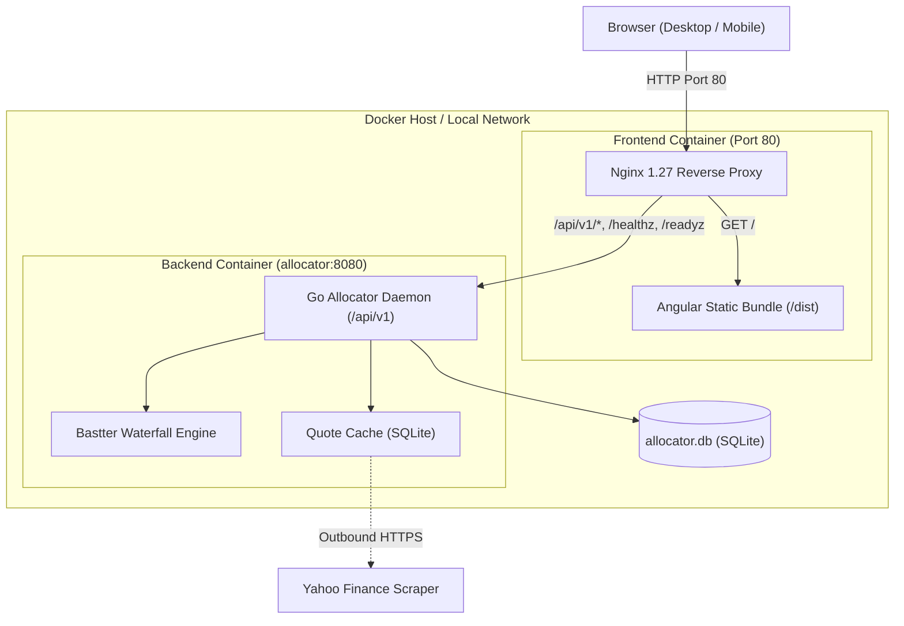
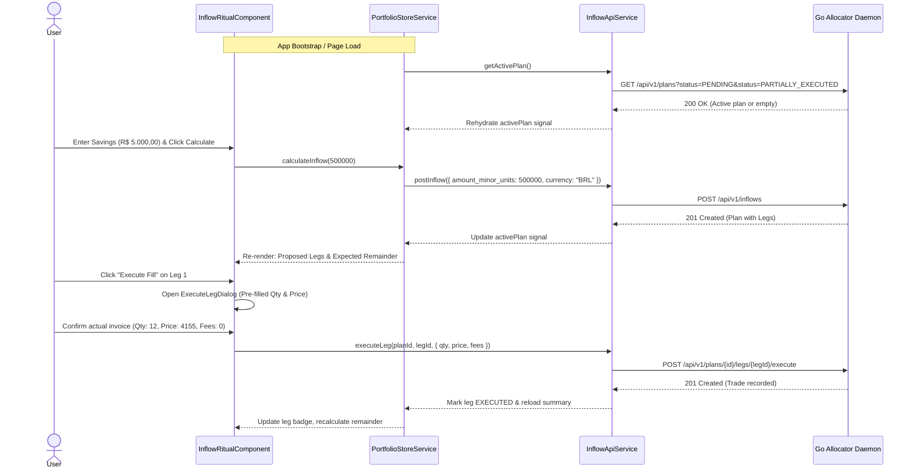

# Investments Allocator Web Frontend

*   **Author:** Gabriel <gabrielssc.ti@gmail.com>
*   **Status:** Approved
*   **Date:** 2026-11-16

--------------------------------------------------------------------------------

## Overview

The Investments Allocator Web Frontend (`investments-allocator-fe`) is a single-user, personal web application built with Angular 19 and Angular Material. It functions as an operational console for the existing Go backend service (`investments-allocator`), which implements the **Bastter greedy waterfall portfolio rebalancing methodology**.

The application provides a layout tailored for two primary workflows:
1. **The Monthly Inflow Workflow:** Inputting monthly savings in Brazilian Real (BRL), executing the greedy waterfall calculation, inspecting the rebalancing buy instructions, and recording real-world broker invoice fills leg-by-leg.
2. **Portfolio & Asset Maintenance:** Mirroring broker holdings, registering micro-assets under macro asset classes (with free-form ticker input and an auto-suggested `.SA` suffix for Brazilian instruments), updating conviction scores (0–10), toggling governance quarantine, deleting unheld mistyped tickers, and maintaining baseline quantities and fixed-income balances.

The frontend is containerized using Docker and served via an Nginx reverse proxy that routes API requests directly to the Go daemon (`http://allocator:8080`), eliminating cross-origin resource sharing (CORS) setup. It provides responsive layouts via Angular CDK `BreakpointObserver`, delivering dense information tables on desktop and stacked card workflows on mobile devices.

--------------------------------------------------------------------------------

## The Problem

The Bastter methodology achieves portfolio rebalancing exclusively through new capital inflows, avoiding asset sales to prevent rebalancing tax drag and sell-side market-timing errors. When new capital arrives, the engine determines which underweight macro asset class and micro security have the largest monetary deficit, directing the full contribution to the single neediest asset (or across multiple greedy waterfall legs).

Currently, interacting with the backend service requires executing manual `curl` commands and parsing raw JSON responses via terminal scripts. This introduces several operational issues:
* **Manual Effort & Typographical Risk:** Entering JSON payloads manually for monthly contributions and broker invoice settlements is cumbersome and prone to typographical errors.
* **Unclear Selection Rationale:** Inspecting raw JSON leaves the user uncertain about why a particular security was chosen over others, masking whether competing assets were bypassed due to the `Freio` (circuit-breaker cooldown) rule, governance quarantine, whole-share lot constraints, or stale market quotes.
* **Real-World Execution Slippage:** The allocator outputs advisory proposals based on cached market prices. When executing orders on a brokerage, fill prices slip, transaction fees apply, and odd-lot constraints alter fill quantities. Furthermore, fixed-income accounts accumulate daily interest (CDI/Selic). Manually adjusting and executing multi-step REST payloads to account for these variances is error-prone.
* **Initial Setup Overhead:** Mirroring an existing brokerage account requires registering numerous instruments, assigning conviction scores, and establishing baseline holdings. Executing this sequentially through CLI tools creates unnecessary friction.

The proposed frontend solves these bottlenecks by providing a single-purpose web console tailored for routine monthly capital deployment and portfolio synchronization.

--------------------------------------------------------------------------------

## Goals

*   **G-1: Streamlined Monthly Inflow Workflow:** Provide a single-view operational flow to input monthly savings in BRL, invoke the Bastter greedy waterfall engine (`POST /api/v1/inflows`), retrieve actionable rebalancing buy instructions (`PlanLeg` quantities, prices, and expected remainder cash), and rehydrate active actionable plans on application load (`GET /api/v1/plans?status=PENDING&status=PARTIALLY_EXECUTED`).
*   **G-2: Independent Advisory Trade Settlement:** Enable recording broker fill invoices leg-by-leg (`POST /api/v1/plans/{id}/legs/{legId}/execute`) with pre-populated, editable inputs (actual fill quantity and unit price for equities; contribution amount and broker statement balance reconciliation for fixed income; fees defaulting to zero). Support partial plan execution where unexecuted legs can be ignored and automatically superseded by subsequent inflows.
*   **G-3: Portfolio Mirroring & Maintenance Workspace:** Provide a clear dashboard displaying macro class allocations (target bps vs. current bps, target minor units vs. current minor units, and monetary deltas) and a management interface to register new assets (with auto-suggested `<TICKER>.SA` suffixes for B3 assets), update conviction scores (0–10), toggle quarantine status, delete unheld mistyped instruments, and adjust baseline holdings.
*   **G-4: Zero Financial Math on Client:** The Go backend remains the single source of truth for portfolio valuation, weight normalization, and waterfall calculations. The frontend handles monetary values strictly as integer minor units (cents represented as JavaScript safe integers within `number` type) and target allocations as integer basis points (`bps`, 10,000 bps = 100%), using custom bidirectional directives to prevent JavaScript floating-point rounding drift.
*   **G-5: Single-Port Containerized Architecture:** Containerize the application using a multi-stage Docker build with Nginx reverse proxying `/api/v1/`, `/healthz`, and `/readyz` to `http://allocator:8080`, eliminating browser CORS configuration and simplifying deployment.
*   **G-6: Responsive Support in Initial Release:** Use Angular CDK `BreakpointObserver` to deliver high-density data tables on desktop viewports and adaptive single-column card flows on mobile screens.

--------------------------------------------------------------------------------

## Non-Goals

*   **NG-1: Multi-Currency & Foreign Exchange:** The frontend operates exclusively in Brazilian Real (`BRL`). Multi-currency conversion and foreign exchange rate caching are out of scope.
*   **NG-2: Historical Audit Ledger Explorer:** Browsing past inflow history or querying historical trade ledgers (`GET /api/v1/inflows`, historical `GET /api/v1/plans`) is excluded. The UI focuses strictly on active portfolio state and the currently actionable monthly allocation plan.
*   **NG-3: Client-Side Rebalancing Simulation:** The frontend will not simulate pro-rata rebalancing, projected future growth, or hypothetical allocations. All decision math is delegated to the Go engine.
*   **NG-4: Sell Orders & Asset Liquidation:** The UI contains no sell order generators or portfolio liquidation features, adhering to the Bastter buy-only invariant.
*   **NG-5: Multi-User Authentication & Authorization:** The application is a personal, single-user system. Authentication, user roles, session tokens, and multi-tenancy are out of scope.
*   **NG-6: Browser-Side Web Scraping:** Direct client-side quote scraping via `yahoo-finance2` is excluded due to browser CORS restrictions and architectural duplication. All quote fetching remains isolated in the Go backend.
*   **NG-7: Live Streaming & Intraday Charting:** Intraday price ticker streams, WebSocket connections, and complex financial charts (candlesticks, technical indicators) are excluded because the workflow does not involve intraday trading.

--------------------------------------------------------------------------------

## Open Questions

*   *None at this stage.*

--------------------------------------------------------------------------------

## Critical User Journeys (CUJs)

### CUJ 1: Monthly Cash Inflow Allocation & Trade Settlement

*   **Given**: The user has R$ 5.000,00 to deploy for the month and opens the application on desktop or mobile.
*   **When**: The user enters `5000,00` into the contribution field and clicks "Calculate Allocation".
*   **Then**: The application calls `POST /api/v1/inflows`, renders the generated plan (e.g., Leg 1: 12 units of `WEGE3` at R$ 41,50 per unit, proposed gross R$ 498,00, expected remainder R$ 2,00), and presents an "Execute Fill" action.
*   **When**: The user executes the trade on their brokerage application at R$ 41,55 per unit, clicks "Execute Fill" in the frontend, verifies the pre-populated values, adjusts the fill price to `41,55`, confirms fees as `0`, and submits.
*   **Then**: The frontend calls `POST /api/v1/plans/{id}/legs/{legId}/execute` with `qty: "12"`, `price_minor_units_per_unit: "4155"`, `fees_minor_units: 0`. The leg status transitions to `EXECUTED`, the holding quantity is updated in the database, and the remaining cash remainder is updated.

### CUJ 2: Initial Portfolio Mirroring & Asset Registration

*   **Given**: The user is configuring the application for the first time and needs to add an existing holding (`PETR4`) under the "National Stocks" macro class.
*   **When**: The user navigates to the "Portfolio & Assets" view and clicks "Register New Asset".
*   **Then**: A dialog opens with required fields: Macro Class, Name, Ticker, Score, Asset Kind, and Lot Rules.
*   **When**: The user selects Macro: "National Stocks", enters Name: "Petrobras PN", and types Ticker: "PETR4". The form automatically populates the Yahoo Symbol field with "PETR4.SA". The user sets Conviction Score: `8` and clicks Save.
*   **Then**: The frontend calls `POST /api/v1/macros/National%20Stocks/instruments`. The instrument appears in the macro table.
*   **When**: The user clicks the holding quantity cell, enters their existing position (`200` units), and triggers blur-save.
*   **Then**: The application calls `PUT /api/v1/positions/{id}/holding` with `{ qty: "200" }` and refreshes the portfolio net worth.

### CUJ 3: Fixed-Income Allocation Execution with Broker Reconciliation

*   **Given**: The greedy waterfall produces an allocation leg for a `BALANCE_TRACKED` fixed-income instrument (e.g., "Tesouro IPCA+ 2029") with a proposed allocation of R$ 1.200,00.
*   **When**: The user clicks "Execute Fill" on the fixed-income leg.
*   **Then**: The execution dialog displays the registered balance (R$ 15.000,00), the proposed deposit amount (R$ 1.200,00), and pre-fills `balance_after` with R$ 16.200,00.
*   **When**: The user checks their broker statement, notices that accrued interest brought the balance prior to deposit to R$ 15.085,20, edits `balance_after` to R$ 16.285,20, and clicks Confirm.
*   **Then**: The frontend calls `POST /api/v1/plans/{id}/legs/{legId}/execute` with `qty: "120000"`, `price_minor_units_per_unit: "1"`, `fees_minor_units: 0`, and `balance_after: 1628520`. The backend records the trade and updates the position balance directly.

### CUJ 4: Multi-Leg Inflow with Partial Execution (Skipping Residual Legs)

*   **Given**: The user contributes R$ 10.000,00. The greedy waterfall engine returns a multi-leg plan:
    *   Leg 1: 150 units of `WEGE3` (National Stocks) for an estimated R$ 6.225,00.
    *   Leg 2: R$ 3.750,00 allocated to a Fixed Income instrument ("Tesouro Selic").
    *   Expected remainder: R$ 25,00.
*   **When**: The user chooses to execute only the equity leg this cycle. They click "Execute Fill" on Leg 1, enter broker invoice numbers, and confirm execution.
*   **Then**: The frontend calls `POST /api/v1/plans/{id}/legs/{leg1Id}/execute`. Leg 1 transitions to `EXECUTED`, and the overall plan status transitions to `PARTIALLY_EXECUTED`.
*   **When**: The user closes the tab or switches mobile apps, and later reopens the frontend.
*   **Then**: On startup, the application calls `GET /api/v1/plans?status=PENDING&status=PARTIALLY_EXECUTED`, rehydrates the active plan, and displays Leg 1 as executed and Leg 2 as pending.
*   **When**: The user intentionally ignores Leg 2 and waits until the subsequent month to contribute again.
*   **Then**: When the user posts a new cash inflow next month, the Go backend automatically marks the remaining pending leg and the prior plan as `SUPERSEDED`, requiring zero manual cancellation.

--------------------------------------------------------------------------------

## Technical Plan (Architecture)

### 1. System Topology & Deployment Architecture

The frontend is packaged as an independent container that communicates with the backend daemon through a Docker network bridge. Nginx acts as a reverse proxy, hosting the Angular single-page application (SPA) while routing API requests internally to the Go backend (`allocator:8080`).



#### Key Deployment Invariants
* **Zero CORS Configuration:** The browser interacts strictly with a single origin (`http://localhost` or host IP). Nginx proxies all API traffic internally to `http://allocator:8080`, removing CORS headers and cross-origin security blocks.
* **Client-Side SPA Routing Fallback:** Nginx handles client-side routing via `try_files $uri $uri/ /index.html;`, ensuring direct URL navigation to sub-routes functions without 404 errors.
* **Isolated Container Liveness:** The frontend container's Docker `HEALTHCHECK` probes local static asset delivery (`http://127.0.0.1:80/`) rather than proxied backend endpoints, ensuring backend restarts do not trigger frontend container restarts.
* **Development Reverse Proxy:** During local development (`npm start` on `:4200`), Angular CLI uses `proxy.conf.json` to proxy `/api/v1`, `/healthz`, and `/readyz` to `http://localhost:8080`, preserving CORS elimination in development.

---

### 2. Angular Application Architecture

The application is built using Angular 19 standards: standalone components, signal-based reactivity, built-in template control flow (`@if`, `@for`, `@switch`), and Angular Material 3.

```text
src/app/
├── core/
│   ├── interceptors/
│   │   └── api-error.interceptor.ts       # Parses backend { error, field } and HTML 502 responses
│   ├── models/
│   │   ├── portfolio.models.ts            # DTOs: Summary, Macro, Instrument, Holding, Quarantine
│   │   └── inflow.models.ts               # DTOs: Inflow, Plan, Leg, Trade, Execution
│   └── services/
│       ├── portfolio-api.service.ts       # HTTP client for /summary, /macros, /instruments, /positions
│       ├── inflow-api.service.ts          # HTTP client for /inflows, /plans, /legs/execute
│       └── portfolio-store.service.ts     # Signal-based state store for active portfolio and plan
├── features/
│   ├── inflow/
│   │   ├── inflow-ritual.component.ts     # Monthly savings input, calculate action, remainder banner
│   │   ├── plan-legs-table.component.ts   # Responsive proposed legs list with execute triggers
│   │   └── execute-leg-dialog.component.ts# Fill dialog: equity invoice inputs and fixed-income reconciliation
│   └── maintenance/
│       ├── maintenance.component.ts       # Portfolio overview: desktop mat-table vs mobile stacked cards
│       ├── register-asset-dialog.component.ts # Micro asset registration modal with .SA auto-suggestion
│       └── quarantine-dialog.component.ts # Modal for setting quarantine status and audit notes
└── shared/
    ├── directives/
    │   └── brl-currency-mask.directive.ts # Bidirectional masking: string display <-> integer cents
    └── pipes/
        ├── brl-currency.pipe.ts           # Formats integer minor units to R$ X.XXX,XX
        └── bps-percent.pipe.ts            # Formats integer basis points (2500) to 25,00%
```

---

### 3. Reactive State Management & Component Interactions



#### State Invariants
1. **Zero Client-Side Math:** All portfolio calculations (deltas, deficits, lot sizes, remainder cash) are performed exclusively by the Go backend. Signals compute only UI-specific view transformations.
2. **Signal-Driven Store:** State is encapsulated in `PortfolioStoreService` exposing readonly signals:
   * `summary`: `Signal<PortfolioSummaryResponse | null>`
   * `activePlan`: `Signal<PlanResponse | null>`
   * `loading`: `Signal<boolean>`
   * `error`: `Signal<string | null>`
3. **Responsive Separation:** `BreakpointObserver` is consumed directly in feature components (`MaintenanceComponent`) to toggle between `mat-table` and mobile card lists, keeping layout logic decoupled from entity data storage.

---

### 4. Data Model Specifications (TypeScript Interfaces)

The frontend contracts map 1:1 with the Go backend OpenAPI schema:

```typescript
// Core Enumerations
export type AssetKind = 'PRICE_QUOTED' | 'BALANCE_TRACKED';
export type LotRules = 'FRACTIONAL' | 'WHOLE_ONLY';
export type PlanStatus = 'PENDING' | 'PARTIALLY_EXECUTED' | 'EXECUTED' | 'CANCELLED' | 'SUPERSEDED';
export type LegStatus = 'PENDING' | 'EXECUTED' | 'CANCELLED';

// Portfolio Models (GET /api/v1/summary)
export interface InstrumentSummary {
  id: number;
  macro_name: string;
  name: string;
  ticker: string;
  yahoo_symbol?: string;
  asset_kind: AssetKind;
  currency: string;
  score: number;
  target_bps_within_macro: number;
  lot_rules: LotRules;
  min_investment_minor_units: number;
  quarantined: boolean;
  quarantined_note?: string;
  holding_qty?: string;
  holding_balance_minor_units?: number;
}

export interface MacroInstrumentView {
  instrument: InstrumentSummary;
  price_per_unit_minor_units: number;
  current_value_minor_units: number;
  quote_stale: boolean;
  feasible: boolean;
}

export interface MacroSummary {
  name: string;
  target_bps: number;
  current_minor_units: number;
  target_minor_units: number;
  delta_minor_units: number;
  instruments: MacroInstrumentView[];
}

export interface PortfolioSummaryResponse {
  total_minor_units: number;
  macros: MacroSummary[];
}

// Inflow Models (POST /api/v1/inflows, GET /api/v1/plans)
export interface CreateInflowRequest {
  amount_minor_units: number;
  currency: string;
  note?: string;
}

export interface InstrumentRef {
  id: number;
  ticker: string;
  name: string;
}

export interface PlanLeg {
  leg_id: number;
  sequence: number;
  instrument: InstrumentRef;
  status: LegStatus;
  proposed_qty?: string;
  proposed_price_minor_units_per_unit?: string;
  proposed_gross_minor_units: number;
  proposed_remainder_minor_units: number;
}

export interface PlanResponse {
  plan_id: number;
  inflow_id: number;
  status: PlanStatus;
  engine_version: string;
  legs: PlanLeg[];
  expected_remainder_minor_units: number;
  rationale_json?: string;
}

// Trade Execution Models (POST /api/v1/plans/{id}/legs/{legId}/execute)
export interface ExecuteLegRequest {
  qty: string;
  price_minor_units_per_unit: string;
  fees_minor_units: number;
  executed_at?: string;
  balance_after?: number; // Required for BALANCE_TRACKED
}

export interface TradeResponse {
  trade_id: number;
  plan_leg_id?: number;
  instrument_id: number;
  qty: string;
  price_minor_units_per_unit: string;
  gross_minor_units: number;
  fees_minor_units: number;
  executed_at: string;
}

// Maintenance Mutation Models
export interface CreateInstrumentRequest {
  name: string;
  ticker: string;
  asset_kind: AssetKind;
  currency?: string;
  yahoo_symbol?: string;
  score: number;
  lot_rules: LotRules;
  min_investment_minor_units: number;
}

export interface UpdateInstrumentRequest {
  name?: string;
  yahoo_symbol?: string;
  score?: number;
  min_investment_minor_units?: number;
}

export interface SetHoldingRequest {
  qty?: string;
  balance_minor_units?: number;
}

export interface SetQuarantineRequest {
  quarantined: boolean;
  note?: string;
}

export interface BackendErrorResponse {
  error: string;
  field?: string;
}
```

---

### 5. Precision & Currency Input Mechanics

To prevent JavaScript floating-point rounding errors:
* **Storage Invariant:** Monetary amounts are stored as integer minor units (cents within safe integer bounds, `Number.MAX_SAFE_INTEGER`, representing values in `number`). R$ 10,50 is stored as `1050`.
* **Bidirectional Input Masking Directive (`[brlCurrencyMask]`):**
  * **On Input/Keystroke:** Strips non-digit characters, interprets digits as cents, and formats display as Brazilian Real (`R$ 10,50`).
  * **On Control Value Write:** Emits integer cents (`1050`) directly to the underlying `FormControl<number>`.
* **Execution Price Serialization:** Unit execution prices and quantities use string decimals (`amount.toString()`) to match Go's `shopspring/decimal` contract.

---

### 6. Responsive Strategy (Angular CDK `BreakpointObserver`)

* **Breakpoint:** Handled via Angular CDK `@angular/cdk/layout` with standard threshold `(max-width: 599.98px)`.
* **Inflow Component:**
  * Uses a single-column, card-based vertical layout on all viewports, allowing execution on mobile while switching between banking/brokerage apps.
* **Portfolio Maintenance Component:**
  * **Desktop ($\ge$ 600px):** Renders high-density `mat-table` with `@include mat.all-component-densities(-2);`, displaying Macro, Ticker, Name, Asset Kind, Conviction Score, Current Holdings, Valuation, Target Delta, and Actions in a single dense view.
  * **Mobile (< 600px):** Switches to an accordion card list. Each card displays Ticker, Score, and Current Valuation, with an "Edit" action opening an edit bottom-sheet modal.

---

### 7. Containerization & Production Build Invariants

* **Multi-Stage Build:** `node:22-alpine` compiles Angular static bundles via `npm run build -- --configuration=production`, outputting to `dist/investments-allocator-fe/browser`.
* **Runtime Image:** `nginx:1.27-alpine` serves static files on port 80.
* **Health Check Invariant:** Probes static file serving locally (`CMD wget -q --spider http://127.0.0.1:80/ || exit 1`).
* **Reverse Proxy Invariant:** Proxies `/api/v1/`, `/healthz`, and `/readyz` to `http://allocator:8080/`.

--------------------------------------------------------------------------------

## Alternatives Considered

### Alternative 1: Client-Side Yahoo Finance Integration via `yahoo-finance2`
* **Description**: Import `yahoo-finance2` into the Angular client to query Yahoo Finance directly for live symbol search-as-you-type and creation-time symbol validation.
* **Pros**: Enables dynamic autocomplete for tickers and instant feedback if an asset symbol does not exist on Yahoo Finance.
* **Cons**: Yahoo Finance query endpoints do not support browser cross-origin requests (CORS), causing immediate browser fetch rejections. The library requires Node.js runtime internals and cookie/crumb session handling. Direct client scraping duplicates the Go backend's `internal/quote` subsystem, bypassing SQLite quote caching.
* **Reason for Rejection**: Browser CORS restrictions prevent client-side Yahoo queries. Free-form text input with an auto-suggested `.SA` suffix provides sufficient usability without scraping overhead.

### Alternative 2: Direct Browser-to-Backend Communication with CORS
* **Description**: Expose the Go backend daemon port (`:8080`) directly to the browser, configure CORS middleware in the Go application, and serve the Angular SPA from a separate port.
* **Pros**: Eliminates Nginx configuration in development.
* **Cons**: Requires modifying the Go backend codebase to inject CORS headers and handle `OPTIONS` preflight requests. Exposes multiple container ports to the host and complicates environment-specific base URL configurations.
* **Reason for Rejection**: Deploying the frontend container with an internal Nginx reverse proxy unifies all traffic under port 80, eliminates CORS requirements, and keeps backend port 8080 internal to the Docker network.

### Alternative 3: Dedicated Multi-Page CRUD Architecture for Assets
* **Description**: Separate portfolio management into distinct routable views: `/instruments`, `/instruments/new`, `/instruments/:id/edit`, and `/positions`.
* **Pros**: Follows conventional RESTful admin layout patterns.
* **Cons**: Requires more navigation steps for a personal portfolio containing relatively few assets. Moving across multiple pages to adjust conviction scores and update quantities is cumbersome compared to a consolidated workspace.
* **Reason for Rejection**: A unified maintenance table supporting inline score updates, inline balance adjustments, and a modal asset registration dialog requires fewer navigation steps than multi-page forms.

### Alternative 4: Historical Inflow & Trade Audit Dashboard
* **Description**: Build a historical ledger explorer to query past inflows (`GET /api/v1/inflows`), inspect previous allocation plans (`GET /api/v1/plans`), and audit past broker invoices.
* **Pros**: Provides historical visibility into portfolio inflows over time.
* **Cons**: Increases frontend maintenance scope without aiding the monthly inflow execution task. The user already retains official transaction invoices and statements with their broker.
* **Reason for Rejection**: The frontend is strictly scoped to the active portfolio status and the currently actionable monthly allocation session.

### Alternative 5: Client-Side Waterfall Simulation & Pro-Rata Rebalancing
* **Description**: Re-implement Bastter deficit ranking and waterfall math in TypeScript to allow client-side previewing and pro-rata rebalancing experiments.
* **Pros**: Allows instant offline simulations without hitting backend endpoints.
* **Cons**: Re-implementing mathematical engine logic in JavaScript introduces calculation drift, risks floating-point discrepancies, violates the single-source-of-truth invariant, and tempts behavioral market-timing errors.
* **Reason for Rejection**: The Go engine remains the authoritative source for all portfolio math.

### Alternative 6: Tailwind CSS Utility Styling
* **Description**: Style the application using Tailwind CSS utilities instead of a pre-built component framework.
* **Pros**: Complete design flexibility and minimal CSS bundle footprint.
* **Cons**: Requires authoring and maintaining complex accessible UI controls from scratch (dialogs, high-density data tables, snackbars, and responsive drawers).
* **Reason for Rejection**: Angular Material 3 provides pre-built accessible components with built-in density scaling (`mat-density`), avoiding custom design overhead.

--------------------------------------------------------------------------------

## Non-Functional Requirements

### 1. Security & Network Isolation
* **Personal Tool Scope:** The application is a single-user local utility. No authentication, user authorization, or credential storage is implemented.
* **Internal Network Boundary:** When deployed with Docker Compose, the Go backend daemon does not expose port 8080 to the public host; only the Nginx frontend port (port 80) is exposed. API access occurs entirely over the internal Docker network bridge.

### 2. Performance & Precision
* **Zero Floating-Point Drift:** The application avoids fractional floating-point calculations for currency and percentage weights, maintaining integer minor units (cents) within safe integer bounds (`number`) and integer basis points (`bps`).
* **Initial Load Target:** Target initial bundle load time under 1 second on a local network using production tree-shaken and gzip-compressed bundles.

### 3. Resilience & Failure Modes
* **Backend Unreachability:** If the Go daemon is stopped or unreachable, the Nginx reverse proxy returns `502 Bad Gateway`. The frontend interceptor intercepts this status and presents a persistent error banner instructing the user to check container health.
* **Quote Stale Visibility:** When the backend marks an instrument with `quote_stale: true` (e.g., due to upstream scraping failure), the UI displays an amber alert chip on the maintenance table.

--------------------------------------------------------------------------------

## Risks & Mitigations

### 1. Local Network Exposure Without Authentication
* **Risk:** The application contains no authentication layer. If bound to `0.0.0.0:80` on an untrusted Wi-Fi or public network, third parties on the same network could view portfolio assets and execute mock trades.
* **Mitigation:** Document clearly in `README.md` that the port binding should remain bound to `127.0.0.1:80` for strictly local execution, or accessed over a private Tailscale mesh network with encrypted machine-level authentication.

### 2. Client-Side Table Rendering at Scale
* **Risk:** `mat-table` renders all micro-instruments under their respective macro classes without pagination. If the portfolio grows to hundreds of instruments, rendering performance could degrade.
* **Mitigation:** Accepted constraint for personal portfolio scale. Typical personal buy-and-hold portfolios track between 15 and 50 securities, well within DOM performance limits.

### 3. Multi-Tab Plan Supersession State Drift
* **Risk:** If a user opens the application across multiple browser tabs, executes an inflow in Tab A, and attempts to execute an older pending leg in Tab B, the backend returns HTTP 409 Conflict because the prior plan was superseded.
* **Mitigation:** The `api-error.interceptor.ts` intercepts HTTP 409 Conflict, surfaces a snackbar notification explaining that the plan was superseded, and triggers `PortfolioStoreService.loadActivePlan()` to synchronize with the current backend state.

### 4. Unvalidated Ticker Typographical Errors
* **Risk:** Free-form ticker input allows accidental typos (e.g. `PETR3.SA` instead of `PETR4.SA`), which fail silently until snapshot time when the backend flags `quote_stale: true`.
* **Mitigation:** Provide a delete action for instruments with zero trade history (`DELETE /api/v1/instruments/{id}`) and clear `quote_stale` badges so typos can be removed and re-added cleanly.

--------------------------------------------------------------------------------

## Additional Resources

* Backend Repository: `../../../investments-allocator`
* OpenAPI Specification: `../../../investments-allocator/docs/openapi.yaml`
* Bastter Methodology Specification: `../../../investments-allocator/bastter_description.md`

--------------------------------------------------------------------------------

## Future Improvements

* **Backend Symbol Validation Hook**: Introduce a dedicated validation endpoint in the Go backend (`GET /api/v1/quotes/validate?symbol=...`) leveraging the existing `yfinance-go` provider, enabling real-time symbol search-as-you-type in the asset creation modal without violating browser CORS.
* **Automated Broker Statement Import**: Allow parsing broker PDF or CSV statements to automatically populate position quantities and fixed-income balances.

--------------------------------------------------------------------------------

## Detailed Implementation Plan

The implementation is structured into seven sequential, buildable phases. Each phase concludes with an explicit verification checkpoint ensuring the repository remains buildable and testable throughout execution.

### Target Files to Create/Modify (Phase 5 Write Allowlist)

#### Configuration & Build Files
1. `package.json` (`Create`): Declares Angular 19 dependencies, Material 3, CDK, and test/build scripts.
2. `angular.json` (`Create`): Configures application build, assets, SCSS styles, and test targets.
3. `tsconfig.json` (`Create`): Base TypeScript configuration with strict mode.
4. `tsconfig.app.json` (`Create`): App-specific TypeScript configuration.
5. `tsconfig.spec.json` (`Create`): Test-specific TypeScript configuration.
6. `proxy.conf.json` (`Create`): Local dev server reverse proxy for `:4200` to `http://localhost:8080`.
7. `.gitignore` (`Create`): Ignores `node_modules/`, `dist/`, `.angular/`, `.env`.
8. `.editorconfig` (`Create`): Formatting hygiene (2-space indent, UTF-8, LF).
9. `README.md` (`Create`): Setup, build, test, and container execution instructions.

#### Containerization & Reverse Proxy Files
10. `Dockerfile` (`Create`): Multi-stage build (`node:22-alpine` builder $\to$ `nginx:1.27-alpine` runtime) with local static health check.
11. `nginx.conf` (`Create`): Nginx configuration with client SPA fallback and reverse proxying to `http://allocator:8080`.
12. `docker-compose.yml` (`Create`): Declares frontend service and joins external `investments-allocator_default` network.

#### Core Layer Files (`src/app/core/`)
13. `src/app/core/models/portfolio.models.ts` (`Create`): TypeScript interfaces for portfolio summary, macros, instruments, holdings, and quarantine.
14. `src/app/core/models/inflow.models.ts` (`Create`): TypeScript interfaces for inflow requests, plans, legs, execution, and trade responses.
15. `src/app/core/services/portfolio-api.service.ts` (`Create`): HTTP service for `/summary`, `/macros`, `/instruments`, `/positions`.
16. `src/app/core/services/inflow-api.service.ts` (`Create`): HTTP service for `/inflows`, `/plans`, `/legs/execute`.
17. `src/app/core/services/portfolio-store.service.ts` (`Create`): Signal-based state store managing summary and active plan rehydration.
18. `src/app/core/interceptors/api-error.interceptor.ts` (`Create`): HTTP interceptor handling `{ error, field }` and HTML 502 errors.
19. `src/app/core/services/portfolio-api.service.spec.ts` (`Create`): Unit test suite for portfolio API calls and error handling.
20. `src/app/core/services/inflow-api.service.spec.ts` (`Create`): Unit test suite for inflow and execution API calls.
21. `src/app/core/services/portfolio-store.service.spec.ts` (`Create`): Unit test suite for signal state store transitions.
22. `src/app/core/interceptors/api-error.interceptor.spec.ts` (`Create`): Unit test suite for error interceptor.

#### Shared Utilities Files (`src/app/shared/`)
23. `src/app/shared/directives/brl-currency-mask.directive.ts` (`Create`): Bidirectional BRL currency masking directive.
24. `src/app/shared/directives/brl-currency-mask.directive.spec.ts` (`Create`): Unit test suite for currency masking directive.
25. `src/app/shared/pipes/brl-currency.pipe.ts` (`Create`): Pipe formatting integer minor units to `R$ X.XXX,XX`.
26. `src/app/shared/pipes/brl-currency.pipe.spec.ts` (`Create`): Unit test suite for currency pipe.
27. `src/app/shared/pipes/bps-percent.pipe.ts` (`Create`): Pipe formatting basis points to percentage (`25,00%`).
28. `src/app/shared/pipes/bps-percent.pipe.spec.ts` (`Create`): Unit test suite for percentage pipe.

#### Feature Components: Inflow (`src/app/features/inflow/`)
29. `src/app/features/inflow/inflow-ritual.component.ts` (`Create`): Monthly inflow savings input, calculate trigger, remainder summary.
30. `src/app/features/inflow/inflow-ritual.component.html` (`Create`): Inflow component template.
31. `src/app/features/inflow/inflow-ritual.component.scss` (`Create`): Inflow component styles.
32. `src/app/features/inflow/inflow-ritual.component.spec.ts` (`Create`): Unit test suite for inflow ritual component.
33. `src/app/features/inflow/plan-legs-table.component.ts` (`Create`): Responsive proposed legs list with execute triggers.
34. `src/app/features/inflow/plan-legs-table.component.html` (`Create`): Plan legs table template.
35. `src/app/features/inflow/plan-legs-table.component.scss` (`Create`): Plan legs table styles.
36. `src/app/features/inflow/plan-legs-table.component.spec.ts` (`Create`): Unit test suite for plan legs table component.
37. `src/app/features/inflow/execute-leg-dialog.component.ts` (`Create`): Execution settlement dialog for equities and fixed income.
38. `src/app/features/inflow/execute-leg-dialog.component.html` (`Create`): Execution settlement dialog template.
39. `src/app/features/inflow/execute-leg-dialog.component.scss` (`Create`): Execution settlement dialog styles.
40. `src/app/features/inflow/execute-leg-dialog.component.spec.ts` (`Create`): Unit test suite for execute leg dialog component.

#### Feature Components: Maintenance (`src/app/features/maintenance/`)
41. `src/app/features/maintenance/maintenance.component.ts` (`Create`): Portfolio maintenance view (desktop table vs. mobile cards).
42. `src/app/features/maintenance/maintenance.component.html` (`Create`): Maintenance component template.
43. `src/app/features/maintenance/maintenance.component.scss` (`Create`): Maintenance component styles.
44. `src/app/features/maintenance/maintenance.component.spec.ts` (`Create`): Unit test suite for maintenance component.
45. `src/app/features/maintenance/register-asset-dialog.component.ts` (`Create`): Modal dialog to register micro-assets.
46. `src/app/features/maintenance/register-asset-dialog.component.html` (`Create`): Register asset dialog template.
47. `src/app/features/maintenance/register-asset-dialog.component.scss` (`Create`): Register asset dialog styles.
48. `src/app/features/maintenance/register-asset-dialog.component.spec.ts` (`Create`): Unit test suite for register asset dialog component.
49. `src/app/features/maintenance/quarantine-dialog.component.ts` (`Create`): Dialog for toggling quarantine and editing audit note.
50. `src/app/features/maintenance/quarantine-dialog.component.html` (`Create`): Quarantine dialog template.
51. `src/app/features/maintenance/quarantine-dialog.component.scss` (`Create`): Quarantine dialog styles.
52. `src/app/features/maintenance/quarantine-dialog.component.spec.ts` (`Create`): Unit test suite for quarantine dialog component.

#### Application Shell & Bootstrap Files (`src/`)
53. `src/index.html` (`Create`): HTML document entrypoint with Material font and icon stylesheets.
54. `src/main.ts` (`Create`): Application bootstrapping entrypoint.
55. `src/app/app.config.ts` (`Create`): Dependency injection configuration, `pt-BR` locale registration, router, interceptors.
56. `src/app/app.routes.ts` (`Create`): Route declarations (`/inflow`, `/portfolio`, default redirect).
57. `src/app/app.component.ts` (`Create`): Shell component with navigation toolbar, total net worth, connectivity banner.
58. `src/app/app.component.html` (`Create`): Shell template.
59. `src/app/app.component.scss` (`Create`): Shell styles.
60. `src/app/app.component.spec.ts` (`Create`): Unit test suite for shell component.
61. `src/styles.scss` (`Create`): Global stylesheet, Angular Material 3 theme palette, compact density overrides.

---

### Phased Execution Sequence

#### Phase 1: Workspace Scaffolding, Angular Configuration & Application Shell
*   **Tasks:**
    1. Initialize `package.json` pinning Angular 19 (`@angular/core`, `@angular/material`, `@angular/cdk`, `@angular/forms`, `@angular/router`), TypeScript 5.5+, and build tooling.
    2. Configure `angular.json` with build targets, SCSS styles, and `proxy.conf.json` proxying `/api/v1`, `/healthz`, and `/readyz` to `http://localhost:8080`.
    3. Configure `tsconfig.json`, `tsconfig.app.json`, `tsconfig.spec.json`, `.editorconfig`, and `.gitignore`.
    4. Create `src/index.html` with Roboto font and Material symbols.
    5. Implement `src/app/app.config.ts` registering `localePt` (`pt-BR`), `{ provide: LOCALE_ID, useValue: 'pt-BR' }`, router, and HTTP client with animations.
    6. Implement `src/app/app.routes.ts` routing `/inflow` and `/portfolio`.
    7. Implement `src/app/app.component.*` with top toolbar, navigation tabs, and net worth display placeholder.
    8. Implement `src/styles.scss` with Material theme and compact table density `@include mat.all-component-densities(-2);`.
*   **Checkpoint Command:** `npm install && npm run build` compiles with 0 errors.

#### Phase 2: Core Domain Models, API Services & Error Interceptor
*   **Tasks:**
    1. Define domain interfaces in `portfolio.models.ts` and `inflow.models.ts` mapping 1:1 to Go backend contracts.
    2. Implement `PortfolioApiService` wrapping `/api/v1/summary`, `/macros/{name}/instruments`, `/instruments/{id}`, `/positions/{id}/holding`, and `/instruments/{id}/quarantine`.
    3. Implement `InflowApiService` wrapping `/api/v1/inflows`, `/plans?status=PENDING,PARTIALLY_EXECUTED`, and `/plans/{id}/legs/{legId}/execute`.
    4. Implement `PortfolioStoreService` signal store managing `summary`, `activePlan`, `loading`, `error`, and methods `loadSummary()`, `loadActivePlan()`, `calculateInflow()`, `executeLeg()`, `updateHolding()`, `updateScore()`, `setQuarantine()`, and `deleteInstrument()`.
    5. Implement `api-error.interceptor.ts` parsing `{ error: string, field?: string }` and HTML 502 responses, mapping them to store error state.
    6. Author unit tests for all services and interceptors.
*   **Checkpoint Command:** `npm test -- --include src/app/core/**/*.spec.ts --watch=false --browsers=ChromeHeadless` passes with 100% test success.

#### Phase 3: Shared Directives & Formatting Pipes
*   **Tasks:**
    1. Implement `brl-currency-mask.directive.ts` providing `ControlValueAccessor`, intercepting keystrokes to format display value, and writing integer minor units (cents) to the form control.
    2. Implement `brl-currency.pipe.ts` formatting minor units to `R$ X.XXX,XX`.
    3. Implement `bps-percent.pipe.ts` formatting basis points to percentage (`25,00%`).
    4. Author unit tests covering boundary values (0 cents, empty strings, pasted inputs).
*   **Checkpoint Command:** `npm test -- --include src/app/shared/**/*.spec.ts --watch=false --browsers=ChromeHeadless` passes.

#### Phase 4: Portfolio Maintenance Feature
*   **Tasks:**
    1. Implement `MaintenanceComponent` injecting `BreakpointObserver`: renders `mat-table` on desktop ($\ge$ 600px) and accordion card list on mobile (< 600px).
    2. Add inline score editing via `<mat-form-field>` saving on blur via `store.updateScore(id, score)`.
    3. Add inline holding editing saving on blur via `store.updateHolding(id, { qty, balance_minor_units })`.
    4. Add delete button for unheld instruments calling `store.deleteInstrument(id)`.
    5. Implement `RegisterAssetDialogComponent` with required `name`, ticker, score, asset kind, lot rules, and `.SA` auto-suggestion for Brazilian macro classes.
    6. Implement `QuarantineDialogComponent` for toggling quarantine and recording audit notes.
    7. Author unit tests for maintenance components and dialogs.
*   **Checkpoint Command:** `npm test -- --include src/app/features/maintenance/**/*.spec.ts --watch=false --browsers=ChromeHeadless` passes.

#### Phase 5: Monthly Inflow Workflow Feature
*   **Tasks:**
    1. Implement `InflowRitualComponent` hosting BRL savings input with `[brlCurrencyMask]`, "Calculate Allocation" action button, and cash remainder display.
    2. Implement `PlanLegsTableComponent` rendering proposed legs with status chips and "Execute Fill" triggers.
    3. Implement `ExecuteLegDialogComponent` handling equity fills (`qty`, `price_minor_units_per_unit: price.toString()`, `fees_minor_units`) and fixed income reconciliation (`price_minor_units_per_unit: "1"`, `qty: depositMinorUnits.toString()`, `balance_after`).
    4. Author unit tests for inflow components and dialogs.
*   **Checkpoint Command:** `npm test -- --include src/app/features/inflow/**/*.spec.ts --watch=false --browsers=ChromeHeadless` passes.

#### Phase 6: Containerization & Reverse Proxy Infrastructure
*   **Tasks:**
    1. Implement multi-stage `Dockerfile` (`node:22-alpine` build $\to$ `nginx:1.27-alpine` runtime) with local static asset healthcheck.
    2. Implement `nginx.conf` with client SPA fallback and reverse proxying to `http://allocator:8080`.
    3. Implement `docker-compose.yml` declaring `investments-allocator_default` external network.
*   **Checkpoint Command:** `docker build -t investments-allocator-fe:test .` succeeds.

#### Phase 7: Full Verification & Quality Gates
*   **Tasks:**
    1. Run full test suite: `npm test -- --watch=false --browsers=ChromeHeadless`.
    2. Run TypeScript strict compilation: `npm run build`.
    3. Execute manual acceptance verification checklist against local Docker environment.
*   **Checkpoint Command:** All automated gates pass with zero failures.

---

### Verification Plan

#### 1. Compilation & Static Analysis
*   **TypeScript Strict Compilation:** `npm run build` must compile without errors under `strict: true`.
*   **Production Build Optimization:** Confirm build produces tree-shaken static artifacts in `dist/investments-allocator-fe/browser`.

#### 2. Unit Testing Suite (`npm test -- --watch=false --browsers=ChromeHeadless`)
*   **Bidirectional Currency Mask Directive:**
    *   Verify typing numbers emits integer cents to form control (typing `500000` sets value `500000` and displays `R$ 5.000,00`).
    *   Verify boundary inputs: 0 cents, empty string resets to null, pasted formatted values.
*   **Signal State Store (`PortfolioStoreService`):**
    *   Verify `loadActivePlan()` rehydrates `activePlan` signal when `GET /api/v1/plans` returns an active plan.
    *   Verify `calculateInflow()` updates `activePlan` signal on successful 201 response.
    *   Verify `executeLeg()` marks target leg `EXECUTED` and triggers `loadSummary()`.
    *   Verify HTTP errors set `error` signal and clear loading state.
*   **Formatting Pipes:**
    *   `BrlCurrencyPipe`: Formats `1050` as `R$ 10,50`, formats `0` as `R$ 0,00`.
    *   `BpsPercentPipe`: Formats `2500` as `25,00%`, formats `10000` as `100,00%`.
*   **Execution Dialog Validation:**
    *   Verify `PRICE_QUOTED` fill requires non-empty quantity and unit price.
    *   Verify `BALANCE_TRACKED` fill sets unit price to `"1"`, `qty` to deposit minor units, and requires non-null `balance_after`.

#### 3. Container & Gateway Verification
*   **Docker Build:** `docker build -t investments-allocator-fe:test .` completes successfully.
*   **Nginx Reverse Proxy Test:** Run container connected to mock backend:
    *   Verify `GET /` serves `index.html` with HTTP 200.
    *   Verify `GET /non-existent-subpath` returns `index.html` with HTTP 200 (HTML5 pushState verification).
    *   Verify `GET /api/v1/summary` proxies to backend and returns JSON.
    *   Verify `GET /healthz` and `GET /readyz` proxy to backend probes.
    *   Verify container health check stays healthy when backend is stopped.

#### 4. Manual Acceptance Verification Checklist (Browser QA against Local Docker Environment)
*   **CUJ 1 Verification (Monthly Inflow):** Launch frontend against live Go backend, input R$ 5.000,00, verify calculated plan legs render with expected remainder, execute fill, and verify trade recorded by checking updated holdings in UI.
*   **CUJ 2 Verification (Asset Registration):** Register a new ticker (`VALE3`), verify `.SA` auto-suffix suggestion, set score, edit holding balance, and verify persistence upon page reload.
*   **CUJ 3 Verification (Fixed-Income Reconciliation):** Generate fixed-income leg, adjust `balance_after` to account for accrued interest, execute, and verify new balance reflected in summary.
*   **CUJ 4 Verification (Partial Execution & Rehydration):** Generate multi-leg plan, execute only leg 1, reload browser tab, verify leg 2 remains pending and actionable, post a second inflow, and verify backend marks previous plan and leg 2 as `SUPERSEDED`.
*   **Responsive Verification:** Test interface on mobile viewport (375x667) using browser devtools: verify Inflow view renders single-column cards and Maintenance view renders stacked cards instead of wide table.

--------------------------------------------------------------------------------

<!-- Provenance: Finalized implementation design via EGM. -->

*Drafted with EGM*
